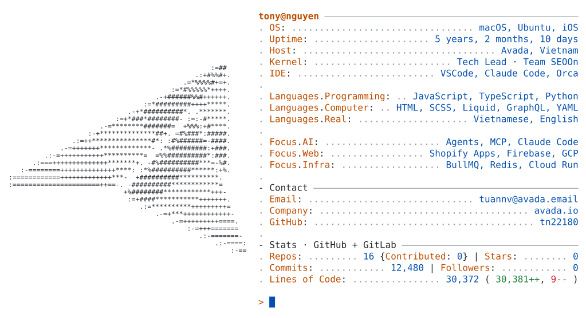

<a href="https://avada.io/">
  <picture>
    <source media="(prefers-color-scheme: dark)" srcset="https://raw.githubusercontent.com/tn22180/tn22180/main/dark_mode.svg">
    
  </picture>
</a>

<a href="https://avada.io/"><picture><source media="(prefers-color-scheme: dark)" srcset="https://raw.githubusercontent.com/tn22180/tn22180/main/link_avada_dark.svg"></picture></a><a href="https://apps.shopify.com/partners/avada"><picture><source media="(prefers-color-scheme: dark)" srcset="https://raw.githubusercontent.com/tn22180/tn22180/main/link_shopify_dark.svg"></picture></a><a href="mailto:tuannv@avada.email"><picture><source media="(prefers-color-scheme: dark)" srcset="https://raw.githubusercontent.com/tn22180/tn22180/main/link_email_dark.svg"></picture></a>

<picture>
  <source media="(prefers-color-scheme: dark)" srcset="https://raw.githubusercontent.com/tn22180/tn22180/main/pacman_dark.svg">
  
</picture>
